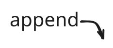
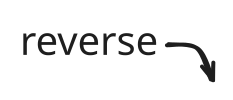
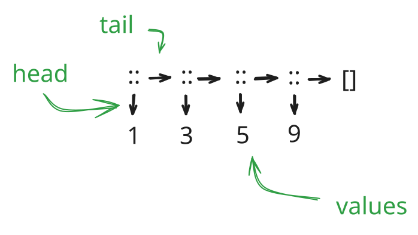
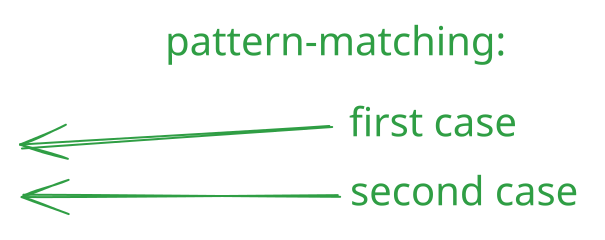
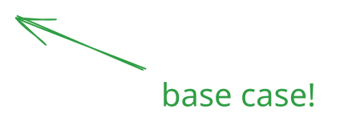

# Foundations of Computer Science: Lecture 3

# Warmup
## Question 1
What does this return?

<x-ocaml nomerlin>
3 + -0.2;;
</x-ocaml>

{pause #q2}
## Question 2
What is the complexity of matrix addition, given a square matrix of size $n$?

{pause}
$$
O(n^2)
$$

{pause up=q2 #q3}
## Question 3
What do we call a function whose computation does not nest?

{pause}
_iterative_ or _tail-recursive_

{pause up=q3}
## Question 4
What is the time/space complexity of **sillySum**

<x-ocaml>
let rec sillySum n =
  if n=0 then
    0
  else
    n + (sillySum (n-1) + sillySum (n-1)) / 2
</x-ocaml>

{pause}
- Time complexity is $O(2^n)$
- Space complexity is $O(n)$

_Consider the space usage as a sequential execution_

<x-ocaml>
sillySum 25;;
</x-ocaml>

{pause up-at-unpause}
# Lists

- A list is a finite sequence of elements
- The elements may have any type
- All elements must have the **same** type

<x-ocaml>
[3; 5; 9];;
</x-ocaml>

<x-ocaml>
[[3.1]; []; [5.7; -0.6]];;
</x-ocaml>

<x-ocaml>
let it = [3;5;9];;
</x-ocaml>

<x-ocaml>
it @ [2; 10];;
</x-ocaml>

<x-ocaml>
List.rev [(1, "one"); (2, "two")];;

{pause up-at-unpause}
# List primitives

We build a list using two primitives:

<pre style="margin:auto;">
[]

::
</pre>

The list `[3; 5; 9]` is constructed as:

<x-ocaml>
let l = 9 :: [];;
let l2 = 5 :: l;;
let l3 = 3 :: l2;;
</x-ocaml>

The two kinds of list:

- `[]` is the **empty list**
- `x::l` is the list with **head** `x` and **tail** `l`

{#listnotation}
List notation:

$$
\left[ x_1; x_2; \ldots; x_n \right] \equiv \underbrace{x_1}_\textrm{head} :: \underbrace{(x_2 :: \ldots (x_n :: []))}_\textrm{tail}
$$

{pause up=listnotation}
Internally, a linked structure

{#linkedlistimg}

Note that `::` is an $O(1)$ operation.
Taking a list's head or tail takes constant time.

{pause up=linkedlistimg}
<x-ocaml>
let rec up_to m n =
  if m > n then []
  else
    m :: up_to (m + 1) n;;
<x-ocaml>

<x-ocaml>
up_to 2 5;;
</x-ocaml>

{pause up-at-unpause}
# Getting at the Head and Tail

<x-ocaml nomerlin>
let hd (x::_) = x;;
</x-ocaml>

<x-ocaml>
List.tl [7;6;5];;
</x-ocaml>

<x-ocaml>
let null = function
  | [] -> true
  | _::_ -> false;;
</x-ocaml>

Note that these three functions are _polymorphic_:

<x-ocaml>
null;; (* is a list empty? *)
hd;; (* head of a non-empty list *)
List.tl;; (* tail of a non-empty list *)
</x-ocaml>

{pause up-at-unpause}
# Computing the length of a list

<x-ocaml>
let rec nlength = function
  | [] -> 0
  | _ :: xs -> 1 + nlength xs;;
</x-ocaml>

## Evaluation:

`nlength [3; 5; 9]` is evaluated as:

$$
\begin{eqnarray}
\texttt{nlength [a; b; c]} &\to& 1 + \texttt{nlength [b; c]}\\
 &\to& 1 + (1 + \texttt{nlength [c]}) \\
 &\to& 1 + (1 + (1 + \texttt{nlength []})) \\
 &\to& 1 + (1 + (1 + 0)) \\
 &\to& 3
\end{eqnarray}
$$

What is the time and space complexity of this function?

{pause up-at-unpause}
# _Efficiently_ computing the length of a list

<x-ocaml>
let rec addlen = function
  | (n, []) -> n
  | (n, _::xs) -> addlen (n+1, xs);;
</x-ocaml>

$$
\begin{eqnarray}
\texttt{addlen (0, [a; b; c])} &\to& \texttt{addlen (1,[b; c])}\\
 &\to& \texttt{addlen (2,[c])} \\
 &\to& \texttt{addlen (3,[])} \\
 &\to& 3 \\
\end{eqnarray}
$$

What is the time and space complexity of this function?

<x-ocaml>
let length l = addlen (0, l);;
</x-ocaml>

{pause up-at-unpause}
# Append: List concatination

<x-ocaml>
let rec append = function
  | ([], ys) -> ys
  | (x::xs, ys) -> x :: append (xs, ys)
</x-ocaml>

$$
\begin{eqnarray}
\texttt{append ([1; 2; 3], [4])} &\to& \texttt{1 :: append ([2; 3], [4])}\\
 &\to& \texttt{1 :: (2 :: append ([3], [4]))} \\
 &\to& \texttt{1 :: (2 :: (3 :: append ([],[4])))} \\
 &\to& \texttt{1 :: (2 :: (3 :: [4]))}\\
 &\to& \texttt{[1; 2; 3; 4]} \\
\end{eqnarray}
$$

What is the time and space complexity of this function?

{pause up-at-unpause}
# Reversing a list in $O(n^2)$

<x-ocaml>
let rec nrev = function
  | [] -> []
  | x::xs -> (nrev xs) @ [x];;
</x-ocaml>

$$
\begin{eqnarray}
\texttt{nrev [a; b; c]} &\to& \texttt{(nrev [b; c]) @ [a]}\\
 &\to& \texttt{((nrev [c]) @ [b]) @ [a]} \\
 &\to& \texttt{(((nrev []) @ [c]) @ [b]) @ [a]} \\
 &\to& \texttt{(([] @ [c]) @ [b]) @ [a]}\\
 &\to& \ldots \\
 &\to& \texttt{[c; b; a]}
\end{eqnarray}
$$

{pause #rev_app}
# Reversing a list in $O(n)$

<x-ocaml>
let rec rev_app = function
  | ([], ys) -> ys
  | (x::xs, ys) -> rev_app (xs, x::ys);;
</x-ocaml>

{pause}
$$
\begin{eqnarray}
\texttt{rev_app ([a; b; c], [])} &\to& \texttt{rev_app ([b; c], [a])}\\
 &\to& \texttt{rev_app ([c], [b; a])} \\
 &\to& \texttt{rev_app ([], [c; b; a])} \\
 &\to& \texttt{[c; b; a]}
\end{eqnarray}
$$